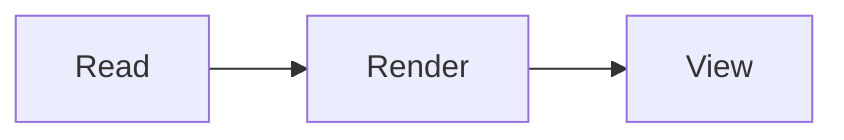
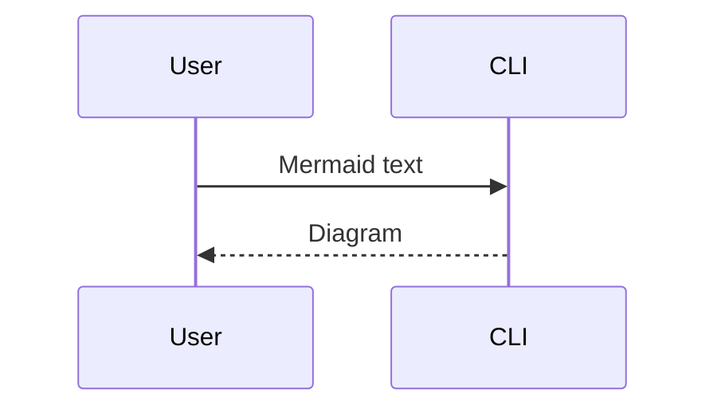

# m2rd

<!-- Workflow badges from .github/workflows/test.yml and .github/workflows/release.yml -->

[](https://github.com/yowainwright/m2rd/actions/workflows/test.yml)
[](https://github.com/yowainwright/m2rd/actions/workflows/release.yml)
[](LICENSE)

m2rd, mermaid to react diagram, is built render mermaid within terminal and web app.
The benefit is being able to see mermaid anywhere, specifically during agentic coding. Other benefits are saving to an image and being able to move the diagram in a react flow plane. The web app specifically, allows you to edit the mermaid display and save that. All of this done in such a way to provide clarity for both the human and agent during planning and documentation phases of development.

Mermaid is the source of truth.
The web page provides a mermaid editor and diagram editor.
The terminal experience provides a cli which renders diagrams via tui.
Coming soon: we're adding an mcp.

---

## usage

To use the web app, just go to https://jeffry.in/m2rd/.

> jeffry.in is my personal site; all posted in [GitHub](https://github.com/yowainwright/yowainwright.github.io) if you're curious (or for security purposes).

You can use it locally if you would like by cloning the project, running install, and run dev.
See the [npm scripts](https://github.com/yowainwright/m2rd/blob/main/package.json#L21-L65) if you want the exact scripts.

```sh
mise install
pnpm install
pnpm run dev
```

To use the cli, pipe the mermaid content in and lets m2rd take care of the rest.

```sh
brew install yowainwright/tap/m2rd
```

> If this project were to et 225+ stars, we will then move it into brew official.
> Until then, I, @yowainwright, will do due diligence to provide release provenance. Please reach out with concerns.

Then run

```sh
printf 'flowchart LR\n  A[Hello] --> B[m2rd]\n' | m2rd
```

You will observe a basic mermaid chart in the Terminal.

That's it!

---

## Release the CLI

Choose one command to release from `main`.

- `pnpm run release:patch` for a bug fix
- `pnpm run release:minor` for a backward-compatible feature
- `pnpm run release:major` for a breaking change

From a clean `main` checkout, `pnpm run release:dry` previews a patch. GitHub Actions tests the selected revision, tags the requested version, and publishes the same attested `m2rd` tarball to GitHub Releases and npm. It opens a formula PR in `yowainwright/homebrew-tap` and deploys the website. Merge the tap PR to make the version available through Homebrew.

For initial setup, create the GitHub environment `npm` with a single deployment rule allowing the branch `main`. The npm package owner must control the public name `m2rd`. For a new package, npm supports reserving the name by staging a first tarball. [npm first-publish instructions](https://docs.npmjs.com/creating-and-publishing-unscoped-public-packages/)

```sh
npm trust github m2rd --repo yowainwright/m2rd --file release.yml --env npm --allow-publish
npm trust list m2rd
```

In npm package settings, select **Require two-factor authentication and disallow tokens**. The publish job uses GitHub OIDC. The tap PR uses the separate `HOMEBREW_TAP_TOKEN` with contents and pull-request write access to the tap. [npm trusted publishing](https://docs.npmjs.com/trusted-publishers/)

## Share a graph

In the editor, open **Share** and choose **Save to GitHub**. Sign in with GitHub to save the Mermaid source, edited React Flow graph, and one SVG frame to an unlisted Gist. Anyone with its link can view and edit a local copy. Copy the saved link from the Share menu.

Each save adds a file to your Gist. Earlier links open the exact revision they originally referenced. Saving edits to someone else's diagram creates a fork in your account with a link back to the original snapshot. If GitHub cannot confirm a save, reopen Share and retry the pending save. Deleting a Gist or revision makes its links unavailable.

<!-- Pending-save recovery from app/components/workspace/header/index.tsx and app/state/constants.ts -->

If retries cannot confirm the save, choose **Discard pending save…** and confirm the warning. Your current edits stay in the editor. **Save to GitHub** then starts a new save, which may create a duplicate if the earlier attempt reached GitHub.

## MCP (super beta)

<!-- Tool inputs and results from packages/server/src/mcp plus runtime and persistence limits from app/graph/snapshot and packages/server/src/auth -->

Connect a client that supports MCP 2026-07-28 to `https://m2rd-api.jeffry.in/mcp` and sign in with GitHub.

| Tool           | Input                                  | Result                                                                            |
| -------------- | -------------------------------------- | --------------------------------------------------------------------------------- |
| `render_text`  | `source`, optional `ascii` and `width` | CLI text for flowchart, sequence, and state diagrams                              |
| `create_graph` | `source`, optional `title`             | Frozen link and SVG for flowchart, sequence, state, class, ER, and Gantt diagrams |

Text width ranges from 16 to 500 columns and defaults to 80. An account can start 10 operations per clock minute and 100 per UTC day, shared across MCP and GitHub saves. A graph creation and its save count as one operation. Mermaid input is limited to 32 KiB, serialized snapshots to 1 MiB, and SVG to 512 KiB. A render has a 10-second deadline.

The SVG is included as an embedded resource. Whether it appears inline depends on the MCP client. Access tokens last 15 minutes and can renew for up to seven days after sign-in. Signing out revokes access across the account's clients. Inactive GitHub credentials expire after seven days. Saved Gists stay in the owner's account.

### Run the API

<!-- Runtime env configuration from packages/server/src/index.ts and SQL schemas in packages/server -->

Use Node 26 and the repository's pinned pnpm. Configure a GitHub OAuth app with callback `https://m2rd-api.jeffry.in/api/auth/callback/github`. Set `GITHUB_CLIENT_ID`, `GITHUB_CLIENT_SECRET`, and `BETTER_AUTH_SECRET` in the service manager. Use an authenticated operator session with the server-only Better Auth client API to create a confidential OAuth client using `client_secret_post` and link it to the resource registered by the MCP plugin. Set its credentials as `MCP_VERIFIER_CLIENT_ID` and `MCP_VERIFIER_CLIENT_SECRET`. [Better Auth resource verification](https://better-auth.com/docs/plugins/oauth-provider/resource-server)

Run these commands for a new SQLite database after preparing the service-owned directory and file permissions. Set `M2RD_DATABASE_PATH` if using a different path.

```sh
sqlite3 /var/lib/m2rd/auth.sqlite < packages/server/schema.sql
sqlite3 /var/lib/m2rd/auth.sqlite < packages/server/usage.sql
pnpm run server:build
pnpm run server:start
```

The API listens on loopback port 3000 by default. `PORT`, `M2RD_API_ORIGIN`, and `M2RD_FRONTEND_ORIGIN` configure the listener and public URLs. Set `NEXT_PUBLIC_M2RD_API_ORIGIN` at frontend build time for a different API. Keep the public authorization and callback URLs reachable through the exe.dev proxy. Use SQLite's backup API and verify restore in a separate database before rollout. [exe.dev proxy](https://exe.dev/docs/proxy) · [SQLite backup API](https://www.sqlite.org/backup.html)

In Cloudflare, create a URL Rewrite Rule that matches `http.host eq "jeffry.in"` and `http.request.uri.path matches "^/m2rd/[0-9a-fA-F]+-[0-9a-fA-F]{40}$"`. Set the rewritten path to the static value `/m2rd/` and preserve the query string. Check the zone's plan support and rule ordering before enabling it. [Cloudflare URL Rewrite Rules](https://developers.cloudflare.com/rules/transform/url-rewrite/)

For a local check, run `pnpm run validate`. Rebuild the frontend with `NEXT_PUBLIC_M2RD_API_ORIGIN=http://127.0.0.1:54785` and run `pnpm run test:e2e` to start the exported site alongside the Koa fixture.

## CLI API

### `m2rd [files...]`

> Type: **`file paths or stdin`**
> Default: **`stdin`**

View Mermaid text or the fenced `mermaid` blocks in Markdown files. Run the viewer in an interactive terminal.

#### Pipe Mermaid text

```sh
printf 'flowchart LR\n  A[Read] --> B[Render] --> C[View]\n' | m2rd
```

#### Read a Markdown file

Save this as `example.md`:

````markdown
# Example diagrams




````

Then open it:

```sh
m2rd example.md
```

Use `n` for the next diagram, `p` for the previous one, and `q` to quit. Arrow keys or `h/j/k/l` scroll the current diagram.

You can also pipe the Markdown:

```sh
cat example.md | m2rd
```

#### Read multiple Markdown files

```sh
m2rd example.md another.md
m2rd docs/*.md
```

Files and diagrams appear in order, one diagram at a time. Markdown files without Mermaid blocks are skipped.

#### Read a Mermaid file

```sh
printf 'flowchart LR\n  A[Start] --> B[Finish]\n' > chart.mmd
m2rd chart.mmd
```

#### Export SVG

Save a diagram from a file or stdin:

```sh
m2rd chart.mmd --output chart.svg
printf 'sequenceDiagram\n  Alice->>Bob: Hello\n' | m2rd -o sequence.svg
```

Export requires exactly one diagram and a new `.svg` filename. It runs without an interactive terminal.

#### Adjust terminal output

```sh
m2rd example.md --width 100 --ascii --no-color
```

`--width` sets the initial layout width. `--ascii` uses plain drawing characters, and `--no-color` disables color.

#### Preview the styleguide

```sh
m2rd --styleguide
m2rd --styleguide --output styleguide.svg
m2rd --styleguide --ascii --no-color > styleguide.txt
```

The first command opens the viewer; the others save an SVG theme sample or a text preview.

---

## License

[MIT](./LICENSE)
